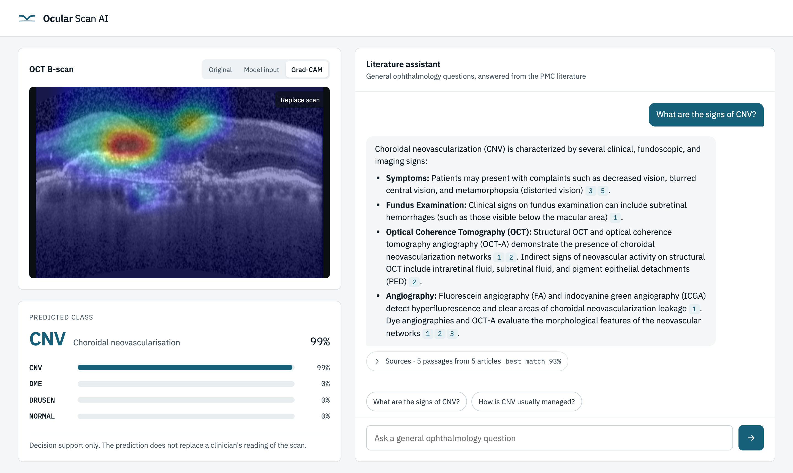

# Ocular Scan AI

[](https://github.com/tasosrigos-bit/ocular-scan-ai/actions/workflows/tests.yml)


**A retinal OCT classifier that is tested on scanners it never saw in training, next
to a literature assistant that answers ophthalmology questions with a citation for
every claim.**

Most OCT models are scored on a held-out slice of the dataset they were trained on, which
shares both the patients and the scanner. This project asks the question a clinic would
ask instead: does the model still work on *our* machine? It trains on one device, picks
its configuration on a second, and confirms the result on real scans from a third.



<sub>A public Kermany test scan classified as CNV, with Grad-CAM showing where the model
looked. Beside it, the assistant answers a general question from the indexed literature,
and each number opens the passage it cites.</sub>

## Highlights

- **Found and fixed data leakage.** 89 percent of the patients in the standard Kermany
  test split also appear in its training split. Everything here is measured on a
  rebuilt patient-level split instead.
- **Measured across devices.** Trained on Heidelberg Spectralis, the delivered model
  reaches 94.5% accuracy (macro-F1 0.931) on 1,137 Optovue scans from OCTDL. On 37 real
  scans from an OPTOPOL clinic device it gets 27 right.
- **An honest failure analysis.** On the clinic scans every CNV, DME and normal scan is
  correct (15 of 15), and drusen accounts for all ten errors. Drusen recall falls from
  0.996 on the training device to 0.828 on OCTDL and 0.545 at the clinic, so the
  weakness lies in the change of scanner rather than in the class itself.
- **Explainable predictions.** Grad-CAM shows where the network looked, and the
  application can switch between the original scan, the preprocessed model input and
  the heat map.
- **A grounded literature assistant.** A LangGraph agent searches 8,535 open-access
  ophthalmology articles from PubMed Central. Retrieval is hybrid (dense embeddings
  plus BM25, fused by reciprocal rank fusion), reranked by a cross-encoder, and served
  from Qdrant. Answers cite their sources by number. The assistant answers
  general questions only and never says what a particular patient has, and drug doses
  are stripped in code, not only by the prompt.
- **Observable in production.** MLflow traces every scan analysis and every question,
  down to each model round, tool call and retrieved passage. Six LLM judges score live
  answers for groundedness, relevance, citations and scope, and the system prompt is
  versioned in the MLflow Prompt Registry.
- **Reproducible.** Every number in the Results section comes from a committed CSV written
  by a script. 116 tests run in GitHub Actions, and Docker Compose starts the
  application with Qdrant and MLflow.

## Results

**The classifier** is ConvNeXt-Tiny at 384×256, fine-tuned for one epoch on the full
Kermany training split. The one-epoch schedule was fixed in advance, because transfer
to the other devices degrades after the first epoch. It was not chosen by reading the
best epoch off the evaluation sets.

| Evaluation set | Device | Role | Accuracy | Macro-F1 | Drusen recall |
| --- | --- | --- | --- | --- | --- |
| Kermany, held-out patients | Heidelberg Spectralis | same device as training | 94.8% | 0.948 | 0.996 |
| OCTDL, 1,137 scans | Optovue Avanti | model selection | 94.5% | 0.931 | 0.828 |
| Clinic, 37 scans | OPTOPOL | confirmation only | 73.0% (27/37) | 0.731 | 0.545 (12/22) |

The configuration was chosen through two screens, each ranked on OCTDL. The first
screened the preprocessing (retina crop, curvature correction, frame shape). The
second screened the backbone, comparing ConvNeXt-Tiny, ResNet-50, ViT-B/16 and a small
custom CNN. The clinic scans were never used to choose anything.

**The retrieval pipeline** was first selected on a 508-article corpus, using 50
generated questions scored by reference-free LLM judges. The chosen configuration
(fixed-size chunks, MedEmbed, hybrid search, gte reranker) scored 1.00 on
faithfulness, 1.00 on answer relevance and 0.83 on context precision. Moving that index
from memory to Qdrant changed nothing that matters. Both stores find the source article
of all 50 questions in their top five, share 4.98 of the five passages on average, and
agree on the top passage every time. For the full 8,535-article corpus, every
combination of chunking, embedding model, retrieval mode and reranker was compared
again in MLflow on 75 new questions, scored against each question's known source
passage with no language model involved. The Docker deployment uses the winner,
section-level chunks with EmbeddingGemma.

## How it works


The assistant is a LangGraph graph of two nodes in a loop, drawn the way LangGraph's
own `get_graph().draw_mermaid()` draws it: solid edges always run, dotted ones are
the conditional branches the model chooses between. The **model** node asks
Gemini for the next step. When it calls `search_corpus`, the **tools** node runs the
hybrid search and the reranker, numbers the passages and hands them back. The model
then writes the answer, with tool calls switched off on the last of at most two
rounds, so every run ends on a written answer. The diagram's source is
[docs/architecture.tex](docs/architecture.tex), drawn in TikZ.

The two halves are deliberately separate. The classifier's output appears on the page
next to the scan, and the assistant never sees the scan or its prediction. The
assistant answers general questions about conditions, their signs, their appearance on
OCT and their management, and leaves the diagnosis of any patient to the clinician.

## Tech stack

| Area | Tools |
| --- | --- |
| Deep learning | PyTorch, torchvision backbones (ConvNeXt, ResNet, ViT) and a custom CNN, Grad-CAM |
| Retrieval and LLM | LangGraph, LangChain, Gemini, sentence-transformers (MedEmbed, EmbeddingGemma), BM25, gte-reranker-modernbert |
| Serving | FastAPI with streamed answers, a plain HTML/CSS/JS front-end |
| Data and MLOps | Qdrant, MLflow (tracing, Prompt Registry, LLM judges, evaluation datasets), Docker Compose |
| Quality | pytest (116 tests), GitHub Actions, uv |

## Quick start

```bash
uv sync
gh release download v0.1.0 --dir experiments --pattern convnext_final_e1.pt
gh release download v0.1.0 --pattern rag-artifacts.tar.gz && tar xzf rag-artifacts.tar.gz
cp .env.example .env    # then set GEMINI_API_KEY
uv run uvicorn app.api:app
```

Open http://localhost:8000. To run it with Qdrant and MLflow alongside, see *Running
with Docker* below.

---

The rest of this README is the full reference: where the data comes from, how the code
is organised, which script produces which result, and how to reproduce each of them.

## Datasets and their roles

The three datasets play different roles and are never mixed. None of them is stored
in this repository. How each one is obtained and where it belongs is described under
*The data* below.

| Dataset | Role | Device | Notes |
| --- | --- | --- | --- |
| Kermany OCT2017 | training | Heidelberg Spectralis | Public. Split is rebuilt at the patient level in notebook 01. |
| OCTDL | selection | Optovue Avanti | Public. Held out. Configurations are ranked on it. |
| Clinic | confirmation | OPTOPOL | 37 de-identified B-scans, shared separately. Confirms, never selects. |

The Kermany test split is not used for reporting because 89 percent of its patients
also appear in training. Notebook 01 shows this and builds a clean patient-level
split instead.

## How the project is organised

The code is split so that computation and presentation never share a file. Scripts
compute and write a small results file. Notebooks read those files and explain the
outcome. No notebook trains a model.

```
ocular/         the package
  config.py       paths, class order, seed (shared by both subsystems)
  service.py      the scan analysis and the assistant's tool loop behind the application
  observability.py  MLflow tracing of both, off unless a tracking server is configured
  classifier/     the image classifier
    preprocess.py   B-scan to a fixed frame, one configurable knob per step
    data.py         caches, loaders, OCTDL and clinic mapping, class weights
    model.py        build_model over several backbones, plus a small custom network
    train.py        a fixed-length training loop, no selection on validation
    eval.py         accuracy, macro-F1, per-class recall
    explain.py      Grad-CAM over the classifier
  rag/            the retrieval assistant: corpus, chunking, index, the Qdrant store,
                  retrieval, rerank, generation, the agent tools and the two pipelines
experiments/    the compute scripts and the result files they write
scripts/        the data-build steps for the retrieval corpus, its indexes and the Qdrant collection
notebooks/      the presentation, read the result files and explain them
app/            the FastAPI service and its web front-end over the classifier and the assistant
tests/          the pytest suite, run on every push by .github/workflows/tests.yml
Dockerfile      the application image; docker-compose.yml adds Qdrant and MLflow
data/           local only, not tracked: raw images, caches, split.csv, corpus, indexes
```

## What runs on what

Each stage is one script that writes one small file or artifact. The notebook for
that stage reads it and reports it. The order below is the order of the work.

The image classifier:

| Stage | Command | Writes | Read by |
| --- | --- | --- | --- |
| Clean split | `notebooks/01_classifier_data.ipynb` | `data/split.csv` | notebook 01 |
| Preprocessing search | `python experiments/run_preprocessing.py --per-class 3000 --epochs 5` | `experiments/results/preprocessing_results.csv` | notebook 02 |
| Model grid | `python experiments/run_models.py --per-class 3000 --epochs 5` | `experiments/results/model_results.csv` | notebook 03 |
| Final training | `python experiments/train_final.py --ckpt experiments/convnext_final.pt` | `experiments/convnext_final_e*.pt` | (the delivered weights) |
| Per-epoch eval | `python experiments/eval_checkpoints.py --ckpt experiments/convnext_final_e1.pt` | `experiments/results/checkpoint_eval.csv` | notebooks 03 and 04 |
| Clinic per-scan | `python experiments/eval_clinic_scan.py` | `experiments/results/clinic_scan_e1.csv` | notebook 04 |

The retrieval assistant:

| Stage | Command | Writes | Read by |
| --- | --- | --- | --- |
| Corpus | `python scripts/build_corpus.py` | `data/corpus/` | notebook 06 |
| Indexes | `python scripts/build_all_indexes.py` | `data/index/` | notebooks 07, 08 |
| Eval questions | `python scripts/build_questions.py --n 50` | `data/eval/questions.jsonl` | notebook 09 |
| Retrieval eval | `python experiments/run_rag_eval.py` | `experiments/results/rag_eval.csv` | notebook 09 |
| Answering eval | `python experiments/run_pipeline_comparison.py` | `experiments/results/rag_eval_pipelines.csv` | notebook 09 |

The preprocessing search and the model grid are screens. They run on a class-balanced
subsample of the training set to rank configurations against one another, so their
numbers are relative and lower than the final model. Only `train_final.py` runs on
the full training set. Local training on Apple silicon is memory bound, which is why
the screens use a subsample rather than the full data.

The result files are committed, so the notebooks can be read and re-run without
repeating any training, search or evaluation.

## The notebooks

The notebooks are meant to be read in order. The first five cover the image
classifier, the last four cover the retrieval assistant. Each one names the functions
that do the work and states the exact command that produced the file it reads.

1. `01_classifier_data.ipynb`. The datasets and their roles, the patient leakage in
   the provided split, and the construction of the clean split that everything else
   depends on.
2. `02_classifier_preprocessing.ipynb`. The preprocessing pipeline step by step, followed by the
   preprocessing search results. The finding is that curvature correction is the change
   that moves the drusen class the most, and that a square frame with squishing transfers
   best.
3. `03_classifier_training.ipynb`. The backbone grid and the final model trained on full
   data, examined epoch by epoch. The finding is that transfer peaks at the first epoch,
   which fixes the training schedule at one epoch.
4. `04_classifier_transfer.ipynb`. The delivered model scored on all three devices. The
   finding is that only drusen fails to transfer, falling from 0.996 on the training
   scanner to 0.545 on the clinic while the other three classes hold, which places the
   weakness in the change of scanner rather than in the class.
5. `05_classifier_explainability.ipynb`. Grad-CAM over the delivered checkpoint, showing
   where the model looks on one scan per class and on the drusen misses.
6. `06_rag_corpus.ipynb`. The ophthalmology corpus, drawn from a whitelist of PubMed
   Central journals and filtered to a reuse-permitting licence.
7. `07_rag_chunking.ipynb`. The three strategies that cut each article into the short
   passages retrieval searches over.
8. `08_rag_retrieval.ipynb`. Embedding the passages, the dense and lexical indexes,
   the three retrieval modes and the reranker.
9. `09_rag_evaluation.ipynb`. The reference-free evaluation that selects the retrieval
   configuration and compares basic against agentic answering.

## Reproducing

Install the environment, then fetch the two release assets from the repository root.

```
uv sync
gh release download v0.1.0 --dir experiments --pattern convnext_final_e1.pt
gh release download v0.1.0 --pattern rag-artifacts.tar.gz && tar xzf rag-artifacts.tar.gz
```

That is enough for notebooks 03 to 09 and for the application, since the results, the
clinic scans and the patient-level split are all in the repository. For the assistant,
copy `.env.example` to a git-ignored `.env` at the repository root and fill in
`GEMINI_API_KEY`, then start the application with

```
uv run uvicorn app.api:app
```

then open http://localhost:8000.

Notebooks 01 and 02 additionally need the two public datasets, described under *The
data* below. Every reported number can be regenerated rather than read, by re-running
the scripts listed under *What runs on what*, but nothing has to be.

## The data

Most of `data/` is not tracked, so the tree has to be assembled once. What is missing,
what is already here and what is rebuilt are three different things.

**The two public datasets have to be downloaded.** They are the only things a fresh
clone is missing.

| Dataset | Source | Size |
| --- | --- | --- |
| Kermany OCT2017 | [data.mendeley.com/datasets/rscbjbr9sj/2](https://data.mendeley.com/datasets/rscbjbr9sj/2), DOI [10.17632/rscbjbr9sj.2](https://doi.org/10.17632/rscbjbr9sj.2) | 5.6 GB |
| OCTDL | [data.mendeley.com/datasets/sncdhf53xc/4](https://data.mendeley.com/datasets/sncdhf53xc/4), DOI [10.17632/sncdhf53xc](https://doi.org/10.17632/sncdhf53xc) | 210 MB |

Version 2 of the Kermany record is the one used here. It carries the `OCT2017`
directory of 84,484 images, 83,484 for training and 1,000 for testing, which are the
counts notebook 01 reports. Unpack it so that `data/raw/OCT2017` holds the `train` and
`test` directories with one subdirectory per class.

Unpack OCTDL so that `data/raw/octdl_dl` holds the `OCTDL` directory. Its label file
is already in this repository, so it does not need to be copied over. The full record
covers seven disease groups, of which only AMD, DME and NO have a counterpart among the
four Kermany classes. `_octdl_frame` in `ocular/classifier/data.py` selects them by the
disease and condition columns and ignores the rest, which reduces the record to the
1,137 images every OCTDL number in this project is measured on. Downloading the whole
record is therefore correct, and the extra groups are simply never read.

**The clinic scans are shared separately.** The 37 de-identified B-scans are
patient-derived, so they are not kept in the repository. They are provided as
`clinic_bscans.zip` through a private link and are unpacked by hand so that
`data/raw/bscans` holds the 37 PNGs and the manifest recording where each was cut from
its report. The source reports, which carry patient name, identifier and date of birth,
are never shared. The scans are checked to carry no burned-in identifier, and they are
needed only for the clinic evaluation in notebooks 04 and 05; the application and every
other notebook run without them. From the repository root,

```
unzip clinic_bscans.zip -d data/raw/
```

puts them in place, so that `data/raw/bscans/` holds the 37 `CLASS_index__laterality.png`
files and `manifest.json`.

**The retrieval artifacts are downloaded or rebuilt.** The corpus, the chunk caches
and the retrieval index are build artifacts, so they are attached to the release rather
than tracked. From the repository root,

```
gh release download v0.1.0 --pattern rag-artifacts.tar.gz
tar xzf rag-artifacts.tar.gz
```

unpacks them into `data/` at 134 MB. That archive carries the corpus, the three chunk
caches that notebook 07 compares, the question set, and the one index the deployed
system uses, `fixed__MedEmbed-base-v0.1`. The other eight indexes of the retrieval experiments
are omitted deliberately, because nothing reads them. Notebook 08 reports that sweep
from the committed `rag_eval.csv`, and rebuilding them is only necessary to repeat the
sweep itself, with `scripts/build_all_indexes.py`.

**The image caches are always rebuilt.** The preprocessed `.npy` stacks are about
6.1 GB and are written on demand by `build_cache`, so they never travel.

**Three small inputs are tracked despite living under `data/`.** These are `split.csv`
at 3 MB, which pins the exact patient-level division every reported number was measured
on, `OCTDL_labels.csv` at 53 KB, which maps the OCTDL vocabulary onto the four classes,
and the corpus manifest at 99 KB, which notebook 06 reads. Carrying them costs little
and removes a regeneration step that could silently diverge.

### Reading the results without the data

Every number and figure this project reports is committed under
`experiments/results/`, so the notebooks that present those results run on a fresh
clone. Notebooks 03 and 09 need nothing beyond the clone. Notebook 05 needs the
delivered checkpoint and the separately provided clinic scans, and notebook 04 needs them
too for the one cell that rescores the clinic set. Notebooks 06 to 08 need the
retrieval archive. Notebooks 01 and 02 build and illustrate the classifier pipeline
itself and are the only two that need the 5.8 GB of downloaded imagery.

### Running the application

The application needs three things, none of which is in the repository. They are the
delivered checkpoint, the retrieval archive above, and an LLM API key in a git-ignored
`.env` at the repository root. `.env.example` lists every setting with where to get
it; copy it to `.env` and fill in at least `GEMINI_API_KEY`. With those in place,

```
uv run uvicorn app.api:app
```

starts it at http://localhost:8000. The page is served by the same process as the
API, `POST /api/predict` for a scan and `POST /api/chat` for the assistant, and the
interactive API documentation is at http://localhost:8000/docs. The embedding model
and the reranker are pulled from Hugging Face on first use and cached there, so the
first question is slower than the rest. If the index is missing the application says so
and repeats the download command rather than failing with a bare path.

### Running with Docker

`docker-compose.yml` runs the application as three containers: the FastAPI service,
Qdrant as the vector store, and an MLflow server that records a trace of every scan
analysis and every question. The checkpoint and the index are mounted from the host
read-only and the key comes from `.env`, so the image holds code only. On the first
run the index is loaded into Qdrant once, which takes a few seconds because the
embeddings are copied rather than recomputed.

```
docker compose up -d --build
docker compose run --rm app python scripts/build_qdrant.py
```

The application is then at http://localhost:8000, the Qdrant dashboard at
http://localhost:6333/dashboard and the traces at http://localhost:5001, under the
`ocular-assistant` experiment. Each question's trace shows the language model rounds
with their token counts, the tool calls with their arguments, and the passages the
search returned with their scores. Running
`uv run --group eval python scripts/register_monitoring.py` once registers the system
prompt in the MLflow Prompt Registry, so every trace records the prompt version it ran
on, and six LLM judges that score new answers as they arrive: retrieval groundedness,
retrieval relevance, relevance to the question, citations, saying so when the
literature falls short, and keeping to general questions without dose or diagnosis.

The application uses Qdrant whenever `QDRANT_URL` is set, as it is in the compose
file, and the in-memory index otherwise, which is what the notebooks and the tests
use. In Qdrant each passage carries its dense embedding and a sparse BM25 vector, and
hybrid search fuses the two rankings with the same reciprocal rank fusion as before.
`experiments/compare_vector_stores.py` checks the move on the 50 evaluation questions,
running the application's retrieval (50 hybrid candidates, reranked to five) on both
stores. Both find the article each question was written from in the final five for
all 50 questions, the two stores share 4.98 of the five passages on average, and they
agree on the top passage every time. The per-question results are in
`experiments/results/vector_store_parity.csv`.

`scripts/build_qdrant.py` copies an index that was already built. A new index can
instead be built straight into Qdrant, embedding the chunks and writing them to the
collection without any index files on disk:

```
uv run python scripts/build_index.py --chunk-strategy fixed \
    --embed-model abhinand/MedEmbed-base-v0.1 --device cpu --qdrant
```

### The full corpus

The evaluated corpus is the 508 newest reusable articles from the journal whitelist.
The whitelist holds 26,299 open-access articles in all, and the full corpus takes
every one whose licence permits reuse, 8,535 articles under CC BY. The rest are
NonCommercial or NoDerivatives (14,900), under publisher-specific terms (about
1,800) or served without text (1,041). It is built into its own folder, so the
evaluated corpus, its questions and its results stay as they were:

```
uv run python scripts/build_corpus.py --all --out-dir data/corpus_full
uv run python scripts/build_all_indexes.py --corpus-dir data/corpus_full --qdrant --device mps
```

The first command searches the whitelist one publication year at a time, past the
9,999 ids a single search returns, and fetches articles 50 to a request with three
requests in flight under NCBI's rate cap. Each article is written as it arrives, so
an interrupted build resumes with what is left. The second embeds all nine chunk
strategy and embedding model combinations straight into Qdrant, as collections named
like `fixed__MedEmbed-base-v0.1__corpus_full`, of 152,000 to 219,000 passages each
depending on the chunking. Every
collection is written batch by batch and resumes from its last batch, so the run can
be stopped and started again. The application searches one of them when
`QDRANT_COLLECTION` names it.

### Running the tests

```
uv run pytest
```

runs the fast suite, which needs none of the data, the checkpoint or an API key. It
covers chunking, the three retrieval modes and the reciprocal rank fusion, the
literature search tool, the assistant's tool loop driven by a scripted model, the image
preprocessing, and every API endpoint with the models replaced by stubs. GitHub
Actions runs the same suite on every push. Two slower tests load the delivered
checkpoint and classify a real clinic scan end to end. They are skipped when those
files are missing and run with

```
uv run pytest -m slow
```

## The delivered model

The delivered model is ConvNeXt-Tiny at 384 by 256 under the cropped,
curvature-corrected, squished pipeline, trained for one epoch on the full training
set. It reaches a macro-F1 of about 0.93 on the unseen OCTDL set and is correct on
27 of the 37 clinic scans. The one epoch schedule is chosen in advance because
transfer degrades after the first epoch, not by reading the best epoch off the
evaluation sets.

The weights are about 110 MB, over the file size that git accepts, so they are not
in the repository. The delivered checkpoint `convnext_final_e1.pt` is attached to
release `v0.1.0`, and everything that loads it expects it at
`experiments/convnext_final_e1.pt`. Download it into place with

```
gh release download v0.1.0 --pattern convnext_final_e1.pt --dir experiments
```

or save it from the Releases page into the `experiments` directory by hand. That
one file is all that is needed. The per-epoch checkpoints behind the training curve
in notebook 03 are not required, because that curve is read from the committed
`experiments/results/checkpoint_eval.csv`.

The path is defined once as `config.CKPT`, so the scripts, the notebooks and the
application all resolve it from there. Calling `config.require_ckpt()` returns it if
present and otherwise raises with the download command above. The weights load with
`build_model("convnext_tiny", pretrained=False)` followed by `load_state_dict`.
